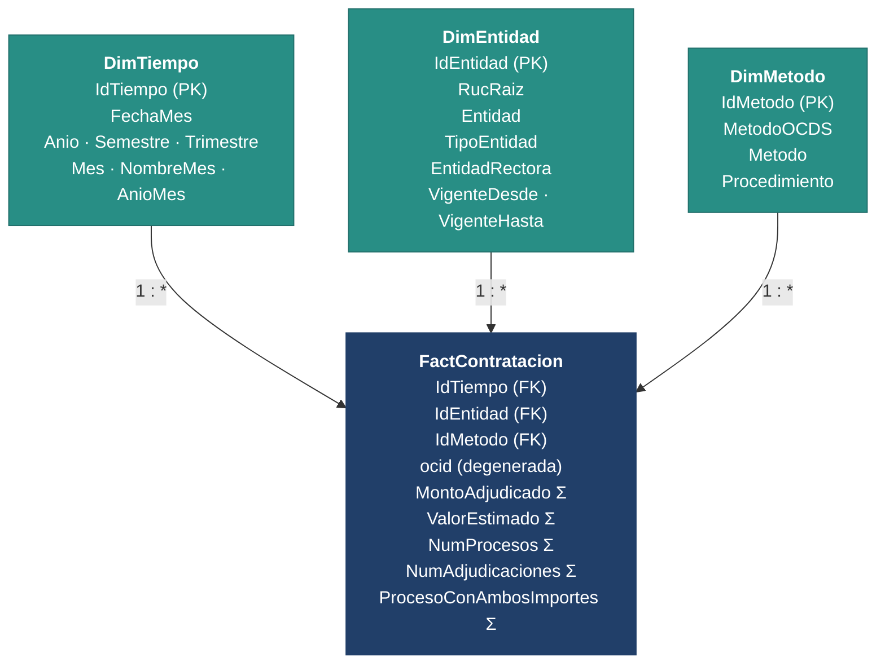

# Diseño dimensional del Hito 3 (los cuatro pasos de Kimball)

- **Estado:** aprobado por el líder el 22/11/2026 en el chat: decisiones (a), (b) y (c) de la sección 9.2, con las precisiones de la sección 6.5. Lo demás sigue lo ya decidido (ADR 0001, 0004 y 0005, y la regla de fecha `releases.date` del 21/11/2026).
- **Fecha:** 22/11/2026. **Equipo:** Grupo 5. **Sector:** gobierno central de Ecuador.
- **Fuente de:** la construcción en Power Query (#70, #71), la sección de diseño del PDF (#73) y las diapositivas (#74).
- **Alcance de esta nota:** diseño y reglas. El modelo **no está construido ni probado** en Power BI Desktop: lo que aquí se afirma de Power BI es un diseño, no un resultado.

## 1. Resumen

Un solo hecho, `FactContratacion`, a grano de **un proceso de contratación (`ocid`) del gobierno central con fecha entre 2021-01 y 2025-12**, y tres dimensiones conformadas: `DimTiempo` (mensual, 60 filas), `DimEntidad` (por raíz de RUC, con tipo de entidad) y `DimMetodo` (método y procedimiento, 28 filas). El hecho guarda claves y medidas aditivas (monto adjudicado, valor estimado y tres conteos), nunca una tasa. Las adjudicaciones múltiples se suman dentro del proceso, el importe ausente queda vacío (no 0) y los compradores fuera del gobierno central o sin clasificar se excluyen del hecho y se cuentan en una tabla de control.

Lo que los datos obligaron a precisar respecto de la propuesta de partida (sección 2): (1) la ventana 2021–2025 deja fuera 14.495 procesos con fecha de 2026, que pesan USD 2.765,71 millones (8,94 % del monto adjudicado nacional); (2) `procurementMethodDetails` tiene 704 valores, de los cuales 681 son nombres de convenios del catálogo electrónico y no métodos, por lo que se colapsa a 27 procedimientos; (3) sumar las adjudicaciones antes de unir evita inflar el valor estimado en USD 1.558,96 millones (6,22 %).

## 2. Contraste de la propuesta con los datos

Medición hecha el 22/11/2026 sobre los CSV del portal descargados el 21/11/2026 (ruta A, años 2021 a 2025, `releases`, `tender` y `awards`), sin filtrar por sector: la clasificación de entidades (#68) aún no existe. Cada cifra sale de `docs/h3/evidencia/medicion-diseno-dimensional-20261122.json`, que genera `scripts/measure_h3_design.py` y que contiene solo conteos y sumas. Donde se indica, coincide con un control de H2 (`docs/h2/calidad.csv`).

| Tema | Cifra medida | Control de H2 | Consecuencia para el diseño |
|---|---|---|---|
| Procesos y ventana | 1.007.920 procesos; 993.425 con `releases.date` entre 2021 y 2025; 14.495 con fecha de 2026; 0 anteriores a 2021; los 60 meses de la ventana tienen procesos | Total 1.007.920 y 0 vacíos en `date` (S-05); 60 meses sin vacío (Q-10) | `DimTiempo` cubre 2021-01 a 2025-12. Los 14.495 procesos de 2026 se excluyen y se cuentan |
| Monto adjudicado | Total nacional USD 30.952.880.306,92; dentro de la ventana USD 28.187.165.730,91; fuera (2026) USD 2.765.714.576,01 en 14.016 procesos con importe | Total 30.952.880.306,92 (calidad y portada de H2) | Cada control se etiqueta por etapa (sección 6.4): nacional descargado (el de H2), nacional 2021-2025 (USD 28.187.165.730,91) y sector listo para combinar (lo mide #68) |
| Año del archivo frente a fecha | 81.898 procesos de la ventana tienen un año de archivo distinto del de su `releases.date` | Q-10 | El año sale de `releases.date`; el año del archivo queda fuera del modelo (decisión D-7) |
| Método | `procurementMethod` toma 4 valores (`open` 129.718, `selective` 576.278, `direct` 272.593, `limited` 2.759 licitaciones); `procurementMethodDetails` toma 704 valores (1 vacío); cada detalle pertenece a un solo método | Hito 1 (cuatro valores) | Jerarquía estricta: el detalle puede ser un nivel inferior sin duplicar filas |
| Detalle del método | 681 de los 704 detalles son del catálogo electrónico (780.097 licitaciones, 79,49 %) y terminan en el nombre de un convenio; los otros 23 son procedimientos (22 con nombre y 1 vacío) | Q-11 (saltos de línea en el detalle) | Se colapsa a 27 pares método-procedimiento (decisión propuesta (a)) |
| Procesos sin licitación | 26.572 procesos no tienen fila en `tender` (sin método ni valor estimado); ninguno tiene adjudicación | 26.572 (matriz de cobertura de H2) | `DimMetodo` necesita el miembro «Sin licitación» |
| Adjudicaciones múltiples | 1.801 procesos con más de una adjudicación (0,19 % de los 964.475 con adjudicación), 10.827 filas adicionales en el universo descargado (9.917 dentro de la ventana, con 1.682 procesos), USD 327.040.896,43 de adjudicado (1,06 % del total); los 1.801 tienen valor estimado | Q-06 | Se suman dentro del proceso. Unir `awards` fila a fila repetiría el valor estimado y lo inflaría en USD 1.558.960.424,49 (6,22 % de USD 25.072.968.705,53) |
| Importes ausentes | 964.450 procesos con importe adjudicado; 25 con filas de adjudicación y todos los importes vacíos; ninguno con importes parciales; 871.555 licitaciones con valor estimado | 43.470 sin monto adjudicado y 109.793 sin valor estimado (Q-01, matriz de cobertura) | Las 25 adjudicaciones sin importe dan monto vacío, no 0; ningún proceso mezcla importes presentes y vacíos |
| Procesos con ambos importes | 868.576 (86,18 %); 861.904 dentro de la ventana; 2.979 solo con valor estimado y 95.874 solo con monto adjudicado | 868.576 (Q-01) | La desviación de P2 se calcula solo sobre el conjunto con ambos importes (marca aditiva) |
| Compradores | 6.100 `buyer_id` distintos que se reducen a 3.364 raíces `EC-RUC-{13}` (3.362 dentro de la ventana); 43 procesos con `buyer_id` sin patrón, sin raíz | Q-07, Q-E06 y Q-E08 | `DimEntidad` tiene una fila por raíz; el sufijo es una unidad y no una entidad. Los 43 procesos sin raíz quedan como no clasificados |

Qué **no** se pudo medir todavía (y por qué): cuántos de los 3.362 compradores y cuántos procesos pertenecen al gobierno central, y su reparto en Presidencia, ministerio e instituto. Depende de la semilla de #68; la sección 6.4 deja la conciliación lista para llenarla con esas cifras.

## 3. Los cuatro pasos (plantilla 6.1 de la guía)

| Tabla de hechos | Proceso | Grano | Dimensiones | Hechos |
|---|---|---|---|---|
| **FactContratacion** | Adjudicación de procesos de contratación pública del gobierno central, desde el proceso hasta la adjudicación según OCDS | Un proceso de contratación (`ocid`) del gobierno central cuya fecha del release (`releases.date`) cae entre enero de 2021 y diciembre de 2025 | Tiempo (mes), Entidad (raíz de RUC), Método (método y procedimiento) | Monto adjudicado, valor estimado, número de procesos, número de adjudicaciones y marca de proceso con ambos importes |

**Paso 1, proceso de negocio.** La actividad que se mide es la contratación del gobierno central: desde que el proceso se publica hasta que se adjudica. Es el proceso que nombran las tres preguntas del Hito 1 (monto adjudicado, desviación frente al valor estimado y serie mensual). La ejecución del contrato queda fuera: solo el 15,33 % de los contratos de 2025 trae importe (ADR 0005, punto 5).

**Paso 2, grano.** Una fila es un proceso (`ocid`) del gobierno central con `releases.date` entre 2021-01 y 2025-12. El `ocid` es único: 0 repetidos en los 1.007.920 procesos (Q-06). Dos consecuencias: (1) el periodo de un proceso lo fija la fecha del release (`releases.date`, decidida el 21/11/2026; es la única fecha presente en el 100 % de los procesos, Q-03), no la fecha de adjudicación, que solo consta en 13,96 % a 17,63 %. OCDS define la fecha del release como la de registro o publicación de la información que ese release contiene ([referencia del esquema](https://standard.open-contracting.org/latest/en/schema/reference/)), así que P1 y P3 son series por fecha del release y no por fecha de publicación inicial del proceso. Inferencia: los identificadores de los releases del portal terminan en `-compiled`, lo que sugiere que son releases compilados cuya fecha refleja el último registro; esto explicaría los procesos con fecha de un año posterior al del archivo (Q-10) y no se verificó con SERCOP; (2) las adjudicaciones se suman dentro del proceso, de modo que el grano no cambia cuando un proceso tiene varias.

**Paso 3, dimensiones.** `DimTiempo`, `DimEntidad` y `DimMetodo`: las perspectivas que nombran P1, P2 y P3 (año y mes, tipo de entidad, método) y nada más. Cumplen el mínimo de la guía (tres dimensiones, una de tiempo). No se agrega una cuarta (decisión D-9).

**Paso 4, hechos.** Medidas aditivas: `MontoAdjudicado` (suma de las adjudicaciones del proceso, USD), `ValorEstimado` (importe de la licitación, USD), `NumProcesos` (siempre 1), `NumAdjudicaciones` (filas de adjudicación colapsadas en el proceso) y `ProcesoConAmbosImportes` (1 si el proceso tiene monto adjudicado y valor estimado, 0 si no). Los dos importes son magnitudes distintas y no se sustituyen entre sí (Hito 1, Parte 2). No hay tasas, porcentajes ni promedios.

## 4. Matriz de bus (plantilla 6.2)

| Tabla de hechos | DimTiempo | DimEntidad | DimMetodo |
|---|:---:|:---:|:---:|
| **FactContratacion** | ✓ | ✓ | ✓ |

Nota: con un solo hecho no hay columna con varias marcas, así que la conformidad se declara por diseño y no se observa en la matriz. Cada dimensión significa lo mismo y tiene los mismos valores para cualquier hecho que se agregue. Un segundo hecho, `FactAdjudicacion` (grano: una adjudicación; H4, solo si se justifica), reutilizaría las tres dimensiones y la matriz tendría dos filas con tres marcas cada una.

## 5. Diagrama del modelo

Boceto para el documento; la imagen del PDF y de las diapositivas es la captura de la vista de modelo de Power BI (#71). Hechos en azul, dimensiones en verde, relaciones de uno a varios desde la dimensión hacia el hecho.

Tabla de control aparte (sin relaciones, no es parte de la estrella): `ControlAlcance`, sección 6.4.

## 6. Tablas y reglas de construcción

### 6.1 FactContratacion

| Columna | Tipo | Regla | Origen |
|---|---|---|---|
| `IdTiempo` | entero (FK) | Año y mes de `releases.date` tal como se escriben (hora de Ecuador, sin convertir de zona): `Año × 100 + Mes` | `Procesos_SERCOP.date` |
| `IdEntidad` | entero (FK) | Clave de la fila de `DimEntidad` de la raíz de 13 dígitos del comprador. Solo se asigna a los procesos admitidos por la secuencia única de la sección 6.5 (pasos 1 a 5); nunca por un cruce directo de la raíz con `DimEntidad` ni por nombre | `Procesos_SERCOP.buyer_id`, semilla (#68) |
| `IdMetodo` | entero (FK) | Clave de `DimMetodo` por `procurementMethod` y procedimiento; «Sin licitación» si el proceso no tiene fila en `tender` | `Licitaciones_SERCOP` |
| `ocid` | texto (dimensión degenerada) | Identificador del proceso; sin tabla propia (decisión D-6) | `Procesos_SERCOP.ocid` |
| `MontoAdjudicado` | decimal anulable | Suma de `amount` de las adjudicaciones del proceso. **Vacío** si el proceso no tiene adjudicaciones o todos sus importes están vacíos (43.470 procesos del universo nacional, ver nota) | `Adjudicaciones_SERCOP.amount` |
| `ValorEstimado` | decimal anulable | `value_amount` de la licitación, sin redondear y sin sustituir vacíos por 0 (Q-01, Q-12). Vacío si no hay fila de `tender` o su importe está vacío | `Licitaciones_SERCOP.value_amount` |
| `NumProcesos` | entero | Siempre 1 | constante |
| `NumAdjudicaciones` | entero | Número de filas de `awards` del proceso (0 si no tiene). Es un conteo: 0 es un cero verdadero | `Adjudicaciones_SERCOP` |
| `ProcesoConAmbosImportes` | entero 0/1 | 1 si `MontoAdjudicado` y `ValorEstimado` no están vacíos; su suma cuenta los procesos del dominio de P2 | derivada de las dos medidas |

Moneda: el 100 % de los importes presentes está en USD (Q-05), por eso no hay columna de moneda.

Nota sobre los 43.470 procesos sin monto adjudicado (universo nacional): 1.007.920 − 964.475 = 43.445 no tienen filas de adjudicación (26.572 de ellos sin fila en `tender` y 16.873 con licitación pero sin adjudicación), y 25 tienen filas de adjudicación con todos los importes vacíos. La cuenta es aritmética sobre los conteos medidos; la causa de cada grupo no se investigó.

### 6.2 DimTiempo

Una fila por mes, 60 filas, 2021-01 a 2025-12. `IdTiempo` es `AAAAMM` entero y es único. Columnas: `FechaMes` (primer día del mes, tipo fecha, para ordenar y para las series de P3), `Anio`, `Semestre` (1 o 2), `Trimestre`, `Mes` (1 a 12), `NombreMes` y `AnioMes` (texto `2025-03`, se ordena por `IdTiempo`). Jerarquía año → mes. Se genera con una lista de meses en Power Query, no desde los datos, para que no falte ningún mes de la ventana aunque un tipo de entidad no tenga procesos en él.

Los meses de 2026 no están: P3 proyecta el primer semestre de 2026 a partir de la serie observada, y la proyección es un resultado del bimestre 2, no un dato fuente.

### 6.3 DimEntidad y DimMetodo

**DimEntidad.** Una fila por raíz de RUC (13 dígitos) de un comprador del gobierno central, más el miembro «Sin clasificar». Estrella: el tipo y el órgano rector van en la misma tabla (entidad → tipo → órgano rector), sin tablas intermedias.

| Columna | Regla |
|---|---|
| `IdEntidad` | Índice desde 1, sin significado de negocio |
| `RucRaiz` | Texto de 13 dígitos; clave de negocio única (Q-E01: relleno con ceros a la izquierda en el catálogo; Q-E02: una fila por raíz) |
| `Entidad` | Nombre de una sola fila por raíz, tomado del catálogo del MDEP o de la semilla; nunca se une por nombre (Q-13) |
| `TipoEntidad` | `Presidencia`, `Ministerio`, `Instituto` o `Sin clasificar` (semilla de #68, ADR 0001 regla 6) |
| `EntidadRectora` | Ministerio u órgano superior cuando conste y esté respaldado; si no, vacío |
| `VigenteDesde`, `VigenteHasta` | Fechas de vigencia de la clasificación si la fuente las da (`valid_from` y `valid_to` de la semilla); vacías si no. Informativas: no filtran ni reasignan procesos (sección 6.5) |

«Sin clasificar» se añade como una fila más antes de numerar el índice. Se espera con 0 filas en el hecho: es una salvaguarda por si faltara una clave, no un destino de datos. La clasificación vigente en la fecha del proceso (SCD tipo 2) pasa al DW de H4 (ADR 0004 y 0005); en H3 hay una sola versión por raíz y la vigencia se guarda como columnas, sin implementarla (sección 6.5). El número de filas depende de #68 (cota superior medida: 3.362 raíces en la ventana, antes de filtrar por sector).

**DimMetodo.** Una fila por par (método, procedimiento): 27 pares observados más «Sin licitación», 28 filas (propuesta (a), sección 9.2).

| Columna | Regla |
|---|---|
| `IdMetodo` | Índice desde 1 |
| `MetodoOCDS` | `procurementMethod` tal como llega: `open`, `selective`, `limited`, `direct`; «Sin licitación» para los procesos sin fila en `tender` |
| `Metodo` | Etiqueta en español de la lista de códigos de OCDS (`open` = Abierto, `selective` = Selectivo, `limited` = Limitado, `direct` = Directo); la traducción es una elección del equipo |
| `Procedimiento` | `procurementMethodDetails` con espacios y saltos de línea normalizados (Q-11). Si empieza por «Catálogo electrónico», se conserva solo el texto anterior a « en el convenio» (4 valores: «Mejor oferta», «Compra directa», «Gran compra puja» y «Gran compra mejor oferta»). Vacío: «Sin detalle» (1 licitación) |

Jerarquía método → procedimiento en una sola tabla. Los 27 pares: abierto 7 (Subasta Inversa Electrónica, Cotización, Licitación, Licitación de Seguros, Concurso público y dos variantes de concurso por lista corta o contratación directa desierta), selectivo 5 (Menor Cuantía, 3 del catálogo y «Sin detalle»), directo 12 (11 con nombre y «Compra directa» del catálogo) y limitado 3. El peso por método en monto adjudicado nacional: abierto USD 18.855,20 millones (60,92 %), directo 7.901,19 (25,53 %), selectivo 3.709,67 (11,98 %) y limitado 486,82 (1,57 %); los procesos sin licitación aportan USD 0 (no tienen adjudicación).

### 6.4 Adjudicaciones múltiples, vacíos y compradores fuera del hecho

**Adjudicaciones múltiples.** Se agrupa `awards` por `ocid` y se suma `amount` antes de unir con el proceso (el hecho tiene exactamente una fila por `ocid`). Efecto en los controles: el monto adjudicado no cambia (la suma por proceso es la suma de las filas) y `Σ NumAdjudicaciones` es igual a las filas de `awards` de los procesos de la etapa que se controla (975.302 en el nacional descargado, 960.375 en el nacional 2021-2025); el valor estimado no se repite. Si se uniera `awards` fila a fila, el hecho tendría filas de más (10.827 en el nacional descargado, 9.917 en el nacional 2021-2025) y `ValorEstimado` sumaría USD 1.558,96 millones de más en el nacional descargado. La causa de las adjudicaciones múltiples (lotes, ítems u otra) no se midió (Q-06); no cambia el diseño porque ninguna de las tres preguntas desglosa por adjudicación.

**Vacío frente a cero.** Un importe ausente es un valor vacío del tipo decimal, no 0: Q-01 lo exige para el valor estimado (un 0 daría divisiones por cero) y Q-12 muestra un caso de 0 en el JSON que el CSV deja vacío. `SUM` en DAX ignora los vacíos y `DIVIDE` devuelve vacío si el denominador es vacío o cero. La marca `ProcesoConAmbosImportes` separa con claridad «sin dato» de «importe 0». Los conteos (`NumProcesos`, `NumAdjudicaciones`) son 0 cuando no hay nada que contar, y eso sí es un cero verdadero.

**Compradores fuera de alcance o sin clasificar.** Se excluyen del hecho y se cuentan (ADR 0001, regla 6; decisión única para #67, #68 y #70). Un comprador cuya raíz no está en la semilla como Presidencia, ministerio o instituto no genera fila, y tampoco los 43 procesos sin raíz. La conciliación se hace en este orden, y cada proceso se cuenta una sola vez:

| Paso | Procesos | Monto adjudicado (USD) | Estado de la cifra |
|---|---:|---:|---|
| Etapa 1: nacional descargado | 1.007.920 | 30.952.880.306,92 | Medido (control de H2) |
| Menos: fecha fuera de 2021-01 a 2025-12 | 14.495 | 2.765.714.576,01 | Medido |
| Etapa 2: nacional 2021-2025 | 993.425 | 28.187.165.730,91 | Medido |
| Menos: fuera del gobierno central | n | n | Lo mide #68 |
| Menos: sin clasificar o dudosos (incluye los 43 sin raíz) | n | n | Lo mide #68 |
| **Etapa 3: sector listo para combinar = filas de FactContratacion** | n | n | Control de #70 |

La tabla `ControlAlcance` (Motivo, Anio, Procesos, MontoAdjudicado) guarda esos conteos en el `.pbix` con los mismos pasos, sin relaciones con el modelo, para mostrar el peso excluido en la página de prueba y en la presentación. `Motivo` toma cuatro valores que no se mezclan: «Fuera de la ventana 2021-2025», «Fuera del gobierno central», «Dudoso o sin clasificar» y «En el hecho»; cada uno con su conteo de procesos y su monto adjudicado, y `Anio` es el año de `releases.date`. Es una tabla de control, no un hecho: no participa en ninguna medida de P1 a P3.

**Cada control pertenece a una etapa y solo cuadra en ella.** Una cifra de una etapa no es el control de otra:

| Control | Etapa 1: nacional descargado | Etapa 2: nacional 2021-2025 | Etapa 3: sector listo para combinar |
|---|---:|---:|---|
| Procesos (`ocid` únicos) | 1.007.920 | 993.425 | n (lo mide #68) |
| Filas de licitación | 981.348 | 966.853 | n |
| Filas de adjudicación (Σ `NumAdjudicaciones`) | 975.302 | 960.375 | n |
| Procesos con varias adjudicaciones | 1.801 | 1.682 | n |
| Filas adicionales por adjudicaciones múltiples | 10.827 | 9.917 | n |
| Monto adjudicado (USD) | 30.952.880.306,92 | 28.187.165.730,91 | n |
| Valor estimado (USD) | 25.072.968.705,53 | 22.805.452.044,61 | n |
| Procesos con ambos importes | 868.576 | 861.904 | n |

Fuente: `docs/h3/evidencia/medicion-diseno-dimensional-20261122.json` (etapas 1 y 2, cifras nacionales sin filtrar por sector). Uso: las acciones de H2 se controlan en la etapa 1 (antes y después); el filtro de fecha explica el paso de la etapa 1 a la 2 (14.495 procesos); el filtro por entidad explica el paso de la 2 a la 3 y lo cuenta `ControlAlcance`. En la etapa 3, la prueba de #70 es que al unir con las tres dimensiones el número de filas y las sumas de `MontoAdjudicado`, `ValorEstimado`, `NumAdjudicaciones` y `ProcesoConAmbosImportes` no cambian, y que ninguna fila queda con el miembro «Sin clasificar». USD 28.187.165.730,91 no es el total del gobierno central: ese total es la suma de las filas de `FactContratacion` y se obtiene al aplicar la clasificación de #68.

### 6.5 Cruce de entidades y vigencia histórica (alineado con ADR 0001 y #68)

- **Secuencia única para asignar `IdEntidad` (ADR 0001, regla 7; la ejecuta #70 sobre la semilla de #68).** Se aplica a los procesos de la etapa 2, en este orden y sin atajos:
  1. Obtener la raíz de 13 dígitos del `buyer_id` (patrón `EC-RUC-{13}` con o sin sufijo). Sin patrón: no hay raíz y el proceso es «Dudoso o sin clasificar» (43 procesos, Q-E08).
  2. Buscar el comprador en la semilla: primero por `buyer_id` completo, sin modificarlo; si no coincide, por la raíz, solo si el patrón se validó en la semilla; nunca por `buyer_name`. Sin coincidencia: «Dudoso o sin clasificar».
  3. Resolver conflictos por raíz: si las filas de la semilla de una misma raíz no coinciden en el tipo de entidad o alguna no está aprobada, la raíz entera es dudosa. La coincidencia exacta no se impone sobre un conflicto: lo dudoso queda fuera (ADR 0001, regla 6) y el diseño no elige entre las clasificaciones; la resuelve el líder en el chat.
  4. Admitir solo los procesos cuyo resultado es Presidencia, ministerio o instituto con estado aprobado. `fuera_de_alcance` cuenta como «Fuera del gobierno central».
  5. Asignar `IdEntidad`, solo a los procesos admitidos, con la fila de `DimEntidad` de su raíz.

  Medido: solo 16,69 % del monto adjudicado cruza con `buyer_id` completo y 80,84 % lo hace por la raíz (Q-E06): la raíz es la que sostiene el modelo, pero pasa siempre por los pasos 3 y 4.
- **Tres motivos de exclusión, separados y sin solaparse.** Fuera de alcance (`fuera_de_alcance` en la semilla: gobiernos locales, empresas, otras funciones del Estado), dudoso o sin clasificar (`sin_clasificar`, estado `dudosa` o `propuesta`, y los 43 procesos sin raíz por `buyer_id` sin patrón, Q-E08) y fuera de la ventana. Un proceso se cuenta en el primer motivo que le toca, en el orden de la tabla de conciliación (ventana, luego los pasos 1 a 4 de esta secuencia).
- **Vigencia histórica y entidades fusionadas en H3.** `DimEntidad` tiene una sola fila por raíz con la clasificación que fije la semilla; no hay versiones por fecha (ADR 0004 y 0005 llevan el SCD tipo 2 al DW de H4; Q-E04 documenta que el catálogo del MDEP es una fotografía al 31/08/2026, sin historia). Cada raíz antigua de una cartera fusionada conserva su propia fila, con su tipo y con `EntidadRectora` apuntando al ministerio actual cuando conste y esté respaldado, de modo que la serie se puede leer por ministerio actual sin reasignar procesos por fecha. Las fechas `VigenteDesde` y `VigenteHasta` se guardan solo si la fuente las da, como columnas informativas. Qué raíces se incluyen o excluyen por haber sido gobierno central en algún periodo de 2021 a 2025 es una decisión de alcance de #68 (Q-E05) y el líder la aprueba en el chat; hasta entonces esas raíces quedan como dudosas, fuera y contadas.

## 7. Pregunta → hechos y dimensiones (guía 4.2)

| Pregunta | Hechos | Dimensiones | Medida DAX que falta (no se guarda) | Por qué no se guarda |
|---|---|---|---|---|
| **P1.** Monto adjudicado por año, método y tipo de entidad, 2021 a 2025 | `MontoAdjudicado` | `DimTiempo` (`Anio`), `DimMetodo` (`Metodo`, `Procedimiento`), `DimEntidad` (`TipoEntidad`) | Ninguna: es la suma de `MontoAdjudicado` | Es aditivo; el hecho ya lo contiene |
| **P2.** Métodos con mayor desviación entre adjudicado y estimado, por tipo de entidad y año | `MontoAdjudicado`, `ValorEstimado`, `ProcesoConAmbosImportes` | `DimMetodo`, `DimEntidad` (`TipoEntidad`), `DimTiempo` (`Anio`) | Desviación % = (ΣA − ΣE) ÷ ΣE × 100, con ΣA y ΣE calculadas solo donde `ProcesoConAmbosImportes` = 1 | Es una razón, no aditiva: sumar las razones de cada proceso no da la razón del grupo (guía 3.2). El hecho guarda numerador y denominador. La marca evita mezclar los 2.979 procesos con solo valor estimado y los 95.874 con solo monto adjudicado |
| **P3.** Monto adjudicado esperado por mes del primer semestre de 2026, por tipo de entidad | `MontoAdjudicado` | `DimTiempo` (`IdTiempo`, mes), `DimEntidad` (`TipoEntidad`) | Monto proyectado mensual (pronóstico de la serie) y error de validación WAPE = Σ\|real − proyectado\| ÷ Σ real × 100 sobre los 12 meses de 2025 | El pronóstico es un resultado de un modelo, no un dato de la fuente, y el WAPE es una razón. Ambos son medidas del bimestre 2; el hecho aporta la serie observada de 60 meses |

Control de referencia para la medida de P2, a nivel nacional y antes de filtrar por sector (no es la respuesta de P2): dentro de la ventana, 861.904 procesos con ambos importes suman USD 20.547.138.708,22 de adjudicado y USD 21.456.965.754,58 de estimado, una desviación agregada de −4,24 %. Sirve para comprobar que la medida DAX calcula bien antes de aplicar el filtro de entidades.

### 7.1 Página de prueba (demostración)

Se propone P1: una matriz con `Anio` y `TipoEntidad` en las filas, `Metodo` en las columnas y la suma de `MontoAdjudicado` como valor, con `Procedimiento` como nivel de profundización. Muestra las tres dimensiones a la vez y permite comprobar el total de la matriz (etapa 3) contra la bitácora y contra la fila «En el hecho» de `ControlAlcance`. La serie de P1 y P3 es por fecha del release. Queda **por verificar en Power BI Desktop** (#71): las relaciones de uno a varios con filtro único, la conciliación del total del sector y el funcionamiento de la página.

## 8. Convenciones y qué se oculta

- **Nombres.** PascalCase con prefijos `Fact` y `Dim` (guía H3 y ADR 0005). Equivalencia con el DW de H4 (ADR 0005): `FactContratacion` = `fact_contract_process`, `DimTiempo` = `dim_date`, `DimEntidad` = `dim_entity`, `DimMetodo` = `dim_method`.
- **Claves.** `IdTiempo`, `IdEntidad` e `IdMetodo`, enteros y únicos en su dimensión. `IdEntidad` e `IdMetodo` son un índice desde 1 sin significado de negocio. `IdTiempo` es `AAAAMM`: se calcula directo de la fecha y no exige un cruce (decisión D-5).
- **Dimensión degenerada.** `ocid`, en el hecho y sin tabla de dimensión.
- **Relaciones.** De uno a varios desde cada dimensión hacia `FactContratacion`, con filtro único; ninguna de varios a varios ni bidireccional.
- **Se oculta en la vista de informe:** `IdTiempo`, `IdEntidad` e `IdMetodo` en las cuatro tablas, `ocid` (solo se muestra en una tabla de detalle), `NumProcesos`, `NumAdjudicaciones` y `ProcesoConAmbosImportes` como columnas (se usan por medio de medidas), `RucRaiz` y `MetodoOCDS`. Se muestran las medidas, no las columnas del hecho.
- **Descripción de tabla.** El grano de la sección 3 se pega en la descripción de `FactContratacion` en Power BI (consejo de la guía, sección 8).
- **Conformidad.** Las tres dimensiones son conformadas por diseño; con un solo hecho se declara en la matriz de bus.

## 9. Decisiones

### 9.1 Decididas (no se reabren) y las que este diseño precisa

| Id | Decisión | Alternativas descartadas y motivo | Origen |
|---|---|---|---|
| D-1 | Un hecho a grano de proceso y tres dimensiones | Hecho a grano de adjudicación: ver decisión (c). Hecho por proceso y mes: no hay medidas que cambien por mes dentro de un proceso | ADR 0004 y 0005 |
| D-2 | Sumar las adjudicaciones dentro del proceso | Unir `awards` fila a fila: 10.827 filas de más y valor estimado inflado en USD 1.558,96 millones (6,22 %). Tomar solo una adjudicación: pierde monto | Issue #67, Q-06; medición de la sección 2 |
| D-3 | Importe ausente = vacío; conteos = 0 | Imputar 0: rompe la desviación de P2 (Q-01) y confunde «sin dato» con «importe 0» (Q-12) | Q-01, Q-12 |
| D-4 | Fecha del release (`releases.date`) como fecha de negocio; ventana 2021-01 a 2025-12 | Fecha de adjudicación: solo 13,96 % a 17,63 % de cobertura (Q-03). Año del archivo: desfasa 81.898 procesos de la ventana (Q-10). Consecuencia declarada: los controles se etiquetan por etapa (sección 6.4); la ventana da USD 28.187.165.730,91 a nivel nacional, que no es el total del sector, y los 14.495 procesos de 2026 (USD 2.765.714.576,01) se informan aparte | Decisión del líder (21/11/2026), ADR 0001 (periodo) |
| D-5 | `IdTiempo` = `AAAAMM` y tiempo mensual | Clave de índice desde 1: obliga a un cruce sin ventaja. Grano diario (`FechaID` AAAAMMDD, sugerido en Q-04): 1.826 filas sin pregunta que las use; P1 es anual y P3 mensual | Guía (nivel de la dimensión de tiempo), P1 y P3 |
| D-6 | `ocid` como dimensión degenerada en el hecho | Quitarlo: no se podría probar el grano (filas = `ocid` distintos) ni mostrar el detalle de un proceso. Costo: una columna de texto de alta cardinalidad; si el `.pbix` resulta demasiado grande, se quita y la prueba de grano se hace en Power Query | ADR 0004, punto 2 |
| D-7 | El año del archivo (`AnioProceso`) no entra al modelo | Columna del hecho: sería la única columna que no es clave, medida ni dimensión degenerada y ninguna pregunta la usa. Se conserva en la consulta intermedia, que no se carga, para el control por archivo | Q-10 |
| D-8 | `NumAdjudicaciones` como medida extra | Omitirla: la pérdida de filas de `awards` al colapsar solo se vería en la bitácora, no en el modelo | Propuesta de este diseño |
| D-9 | Sin cuarta dimensión (proveedor, geografía) | Proveedor: ninguna pregunta lo usa y puede ser una persona natural; el repositorio no guarda datos de personas (`CLAUDE.md`). Geografía: ninguna pregunta la usa. Se prefieren pocas dimensiones bien pensadas (guía, sección 8) | Guía H3, P1 a P3 |
| D-10 | Estrella con `DimEntidad` y `DimMetodo` desnormalizadas | Copo de nieve (tipo y método en tablas aparte): Power BI rinde mejor con estrella (guía 3.3) | Guía H3 |

### 9.2 Decisiones aprobadas por el líder el 22/11/2026

**(a) Método: con o sin `procurementMethodDetails`. Aprobada con detalle normalizado.**
- **Recomendación firme: con detalle, colapsado a procedimiento** (`Metodo` → `Procedimiento`, 28 filas).
- **Motivo.** Con solo `procurementMethod` (4 valores) P2 mezclaría en «abierto» la subasta inversa (USD 8.438,96 millones, 109.792 licitaciones), la licitación (USD 6.387,50 millones, 5.321) y la cotización (USD 3.028,49 millones, 10.007), tres procedimientos de peso muy distinto que «abierto» agrupa. Con los 704 detalles completos, 681 son nombres de convenios del catálogo y no métodos: el 97 % de los miembros sería ruido y las celdas de método × tipo de entidad × año quedarían casi vacías. El colapso usa una regla observada (el texto anterior a « en el convenio») y no inventa categorías.
- **Alternativas.** (i) Solo 4 métodos: 5 filas, más simple, pierde la lectura por procedimiento. (ii) 704 detalles: descartada por lo anterior. Elegir (i) es reversible sin tocar la forma del hecho: se oculta `Procedimiento` y quedan los 4 métodos.
- **Confirmado por el líder:** etiquetas de `Metodo` Abierto, Selectivo, Limitado y Directo (elección del equipo, no de la fuente). `Metodo` es el nivel principal en P1 y P2 y `Procedimiento` el de profundización: «Abierto» se desglosa en subasta inversa, licitación y cotización.

**(b) Alcance de entidades y peso excluido. Aprobada.**
- **Recomendación firme:** el hecho solo contiene procesos de Presidencia, ministerios e institutos (ya decidido); lo demás se excluye y se muestra con una tabla de control `ControlAlcance` (sección 6.4), alimentada con los mismos pasos de conciliación, más una nota en el PDF con el porcentaje de procesos y de monto excluido por motivo.
- **Motivo.** Los 1.007.920 procesos incluyen gobiernos locales, empresas y otras funciones del Estado (6.100 `buyer_id`, 3.364 raíces); meterlos al hecho para «verlos» agrandaría el `.pbix` (el de H2 pesa 243 MB) y obligaría a filtrar siempre en DAX, con riesgo de mezclar alcances. La tabla de control da el mismo dato sin ese riesgo.
- **Alternativa descartada.** Conservar todos los procesos con `TipoEntidad` = «Fuera de alcance» o «Sin clasificar» en el hecho: el total cuadra con el nacional sin tabla aparte, pero contradice la regla ya decidida (ADR 0001, regla 6).
- **Los casos dudosos** (compradores que podrían ser del gobierno central con denominaciones históricas, Q-E05: 41.776 procesos y USD 765,66 millones sin cruce con el catálogo) se aprueban en el chat con la lista corta de #68. Mientras no se aprueben quedan fuera y contados.

**(c) Segundo hecho `FactAdjudicacion`. Aprobada: un solo hecho.**
- **Recomendación firme: descartarlo en H3**, dejarlo anotado para H4.
- **Motivo.** P1, P2 y P3 se contestan completas a grano de proceso: el método, la entidad y el periodo son atributos del proceso, y la suma de las adjudicaciones por proceso es igual a la suma de sus filas. Solo 1.801 procesos (0,19 %) tienen varias adjudicaciones y pesan 1,06 % del monto adjudicado; por qué hay varias no se midió (Q-06). A grano de adjudicación la fecha tendría que ser la de la adjudicación (13,96 % a 17,63 % de cobertura, Q-03) y no la de `releases.date`, y ninguna de las tres preguntas necesitaría una dimensión nueva (el proveedor no se usa y puede ser una persona natural).
- **Condición para reabrirla en H4:** que aparezca una pregunta que exija analizar adjudicaciones individuales.
- **Si se añadiera en H4:** reutiliza `DimTiempo`, `DimEntidad` y `DimMetodo`, que ya son conformadas, y no cambia `FactContratacion`.

## 10. Verificación contra los criterios del issue y la rúbrica

| Criterio | Cumple | Dónde |
|---|---|---|
| Proceso, grano (una frase), dimensiones y hechos por escrito, en orden de Kimball | Sí | Sección 3 |
| Al menos un hecho y tres dimensiones, una de tiempo | Sí (1 hecho, 3 dimensiones) | Secciones 3 y 5 |
| Matriz de bus completa y coherente | Sí | Sección 4 |
| P1, P2 y P3 asociadas a hechos y dimensiones; P2 y P3 explican la medida DAX que falta y por qué no se guarda | Sí | Sección 7 |
| Ninguna tasa, porcentaje ni promedio en una tabla de hechos | Sí: solo importes, conteos y una marca 0/1 | Sección 6.1 |
| Varias adjudicaciones, importes vacíos y compradores no clasificados decididos por escrito | Sí | Sección 6.4 |
| Decisiones del líder con su recomendación | Sí: (a), (b) y (c), aprobadas el 22/11/2026 | Sección 9.2 |
| Sin marcas pendientes | Sí | Todo el documento |
| Estrella, no copo de nieve | Sí: tres dimensiones desnormalizadas, relaciones directas | Secciones 5 y 8 |

**Lo probado:** las cifras de las secciones 2 y 6, medidas con `scripts/measure_h3_design.py` sobre los CSV de 2021 a 2025 (el script rechaza dos descargas del mismo año y `ocid` repetidos en `releases`; pruebas sintéticas en `tests/unit/test_measure_h3_design.py`) y contrastadas con los controles de H2 (1.007.920 procesos, 981.348 licitaciones, 975.302 adjudicaciones, USD 30.952.880.306,92 adjudicado, USD 25.072.968.705,53 estimado, 868.576 procesos con ambos importes, 1.801 con varias adjudicaciones y 10.827 filas adicionales).

**Lo simulado:** nada.

**Lo pendiente:** el número de filas de `DimEntidad` y la conciliación por tipo de entidad (dependen de la semilla de #68); la construcción y el peso del `.pbix` con `ocid` (#70 y #71); las medidas DAX, que son del bimestre 2 salvo la de la página de prueba. Las cifras son nacionales y del portal al 21/11/2026: el portal se actualiza a diario y una descarga posterior puede dar valores algo distintos (se concilia con H2, no se corrige).
